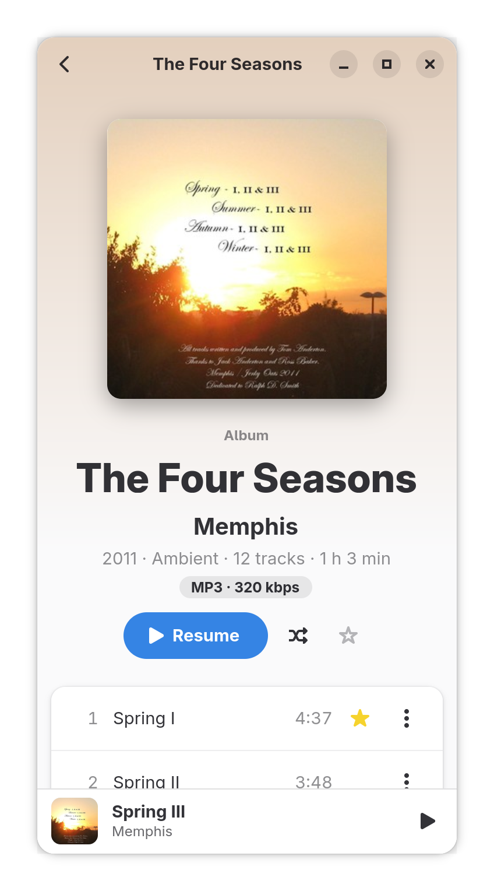
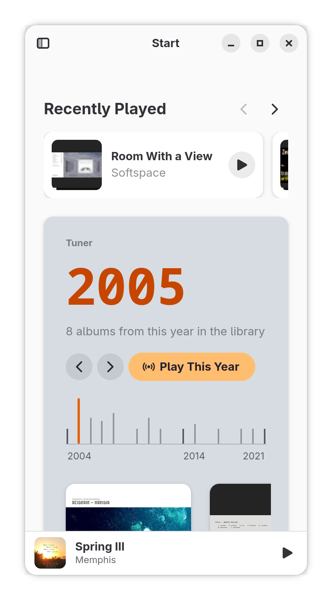

<p align="center">
  
</p>

<h1 align="center">Vumi</h1>

<p align="center">
  A fast GTK 4 music player for Navidrome and other Subsonic servers, written in Rust.
  With the AudioMuse-AI plugin on your Navidrome server, it also plays similar songs and
  radio from the Start page and album pages.
</p>

<p align="center">
  <a href="https://github.com/TomaszBojanowski/vumi/releases/latest"></a>
  <a href="LICENSE"></a>
  <a href="https://flatpak.bojanowski.me/io.github.tomaszbojanowski.Vumi.flatpakref"></a>
</p>

<p align="center">
  <picture>
    <source media="(prefers-color-scheme: dark)" srcset="data/screenshots/start-dark.png">
    
  </picture>
</p>

<p align="center">
  <b>0.22&nbsp;s</b> from start to my library on screen · <b>133&nbsp;MB</b> of memory while idle<br>
  <sub>Vumi 0.1.3, 651 albums from a Navidrome server in my local network, medians of 5 runs: see <a href="#speed">Speed</a></sub>
</p>

Website: [vumi.bojanowski.me](https://vumi.bojanowski.me/)

> Early development: I use it every day with my own library, but expect rough
> edges.

## Features

### Library

- **Instant start** from a local SQLite cache: the UI never waits for the network.
- **Local full-text search** (FTS5) over the whole library.
- **Albums, artists, playlists and favorites**, with composers on album pages.

### Start page

- **Recently played** albums, each resumed where it stopped.
- **The Tuner:** a scale of the years in the library, with Play This Year.
- **Recently added** albums, and albums with songs similar to what played last.

### Playback

- **Gapless playback**, repeat (queue or track), optional ReplayGain normalization.
- **AudioMuse-AI through Navidrome:** similar songs, endless radio, album radio.
- **Scrobbling** and a live "now playing" (OpenSubsonic, Navidrome 0.62+), both optional.

### GNOME integration

- **Keeps playing** after the window is closed, with MPRIS controls in GNOME Shell.
- **Light and dark style**, with colors taken from the album cover (optional).
- **Narrow and low windows:** down to 360 px wide, with a compact player bar.
- **Keyboard shortcuts:** Ctrl+? lists them all.

<p align="center">
  <picture>
    <source media="(prefers-color-scheme: dark)" srcset="data/screenshots/album-narrow-dark.png">
    
  </picture>
  &nbsp;
  <picture>
    <source media="(prefers-color-scheme: dark)" srcset="data/screenshots/start-narrow-dark.png">
    
  </picture>
  <br>
  <sub>An album page and the Start page in a narrow window: the player becomes a bar at the bottom.</sub>
</p>

## Speed

Vumi is a native GTK 4 app written in Rust, with no web browser inside. Measured on my
library: 651 albums and 11,333 songs on a Navidrome server in my local network.

| Measurement | Vumi 0.1.3 |
|---|---|
| From start to the library on screen (saved login) | 0.22 s |
| From the first login to the albums | 0.53 s |
| The window's first frame | 166 ms (282 ms on a cold start) |
| CPU while idle | under 0.03 % of one core |
| Memory while idle | 133 MB (all of Vumi's processes, PSS) |
| From a typed phrase to the search results | 186 ms (150 ms of it is the search field's typing delay) |
| CPU while music plays, window in the background | 0.45 % of one core |
| CPU while music plays, album page in front | 1.3 % of one core |

Vumi 0.1.3, medians of 5 runs on my PC (AMD Ryzen 7 9700X), in a test compositor at 120 Hz.

## Install

```sh
flatpak install --user https://flatpak.bojanowski.me/io.github.tomaszbojanowski.Vumi.flatpakref
```

The GNOME runtime it needs comes from Flathub. Updates arrive with
`flatpak update` or in GNOME Software.

You need a Navidrome server, or another server that speaks the Subsonic or
OpenSubsonic API (tested with Navidrome 0.64).

Without the repository: download `vumi-X.Y.Z.flatpak` from
[Releases](https://github.com/TomaszBojanowski/vumi/releases) and install it
with `flatpak install --user vumi-X.Y.Z.flatpak`. Such a bundle does not
update itself.

## Building

Vumi is built and run as a Flatpak. The `devel` branch keeps a build from source
next to a Vumi installed from the repository, instead of replacing it:

```sh
flatpak-builder --user --install --install-deps-from=flathub --force-clean \
    --default-branch=devel flatpak-build io.github.tomaszbojanowski.Vumi.yml
flatpak run io.github.tomaszbojanowski.Vumi//devel
```

The installed `devel` branch becomes the current one, so the app menu starts it;
this makes the released version current again:

```sh
flatpak make-current --user io.github.tomaszbojanowski.Vumi master
```

## Architecture

- `subsonic/`: async Subsonic API client (tokio + reqwest), typed errors.
- `app/`: GTK4/libadwaita GUI. The UI reads from a local SQLite database;
  a background sync keeps it up to date with the server.
- `cli/`: command-line test tool for the engine.

## Translations

The interface is translated with gettext; the files are in `po/`.
Polish is complete.

## How Vumi is made

Vumi's code is written with Claude Code, an AI coding assistant, under my
direction. I decide what Vumi does and how it looks, plan each change, and
test every release on my own library before it ships.

## License

Vumi is free software, released under the GNU General Public License,
version 3 or later. See [LICENSE](LICENSE).
