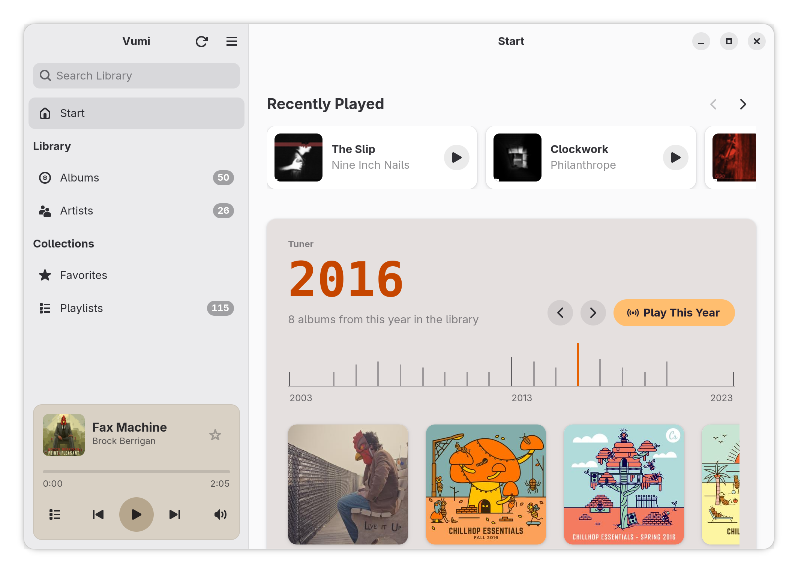

# Vumi

A fast GTK4/libadwaita music player for Navidrome and other Subsonic servers,
with first-class AudioMuse-AI integration. Written in Rust.

> Early development: used every day with the author's own library, but expect
> rough edges.



## Features

- **Instant start:** the library comes from a local SQLite cache, so it is on
  screen in a fraction of a second; the UI never waits for the network.
- **Local full-text search** (FTS5) over the whole library.
- **Albums, artists, playlists and favorites**, with composers on album pages.
- **Start page:** the albums played lately, each resumed where it stopped;
  the Tuner, a scale of the years in the library with Play This Year;
  recently added albums; and albums with songs similar to what played last.
- **Gapless playback**, repeat (queue or track), and optional volume
  normalization from ReplayGain tags (off by default).
- **AudioMuse-AI through Navidrome:** similar songs, endless radio, album radio.
- **Keeps playing after the window is closed**, with MPRIS controls in GNOME Shell.
- **Scrobbling** to the server, and a live "now playing" with pause and position
  on servers with the OpenSubsonic `playbackReport` extension (Navidrome 0.62
  and later). Both can be turned off.
- **Light and dark style**, and colors taken from the album cover (optional).
- **Narrow and low windows:** down to 366 px wide the sidebar folds away and
  a compact player bar stays at the bottom; in low windows the player card
  in the sidebar gets a small cover.
- **Keyboard shortcuts:** Ctrl+? lists them all.


## Install

```sh
flatpak install --user https://flatpak.bojanowski.me/io.github.tomaszbojanowski.Vumi.flatpakref
```

The GNOME runtime it needs comes from Flathub. Updates arrive with
`flatpak update` or in GNOME Software.

You need a Navidrome server, or another server that speaks the Subsonic or
OpenSubsonic API (tested with Navidrome 0.64).

Without the repository: download `vumi-X.Y.Z.flatpak` from
[Releases](https://github.com/TomaszBojanowski/vumi/releases) and install it
with `flatpak install --user vumi-X.Y.Z.flatpak`. Such a bundle does not
update itself.

## Building

Vumi is built and run as a Flatpak:

```sh
flatpak-builder --user --install --install-deps-from=flathub --force-clean \
    flatpak-build io.github.tomaszbojanowski.Vumi.yml
flatpak run io.github.tomaszbojanowski.Vumi
```

## Architecture

- `subsonic/`: async Subsonic API client (tokio + reqwest), typed errors.
- `app/`: GTK4/libadwaita GUI. The UI reads from a local SQLite database;
  a background sync keeps it up to date with the server.
- `cli/`: command-line test tool for the engine.

## Translations

The interface is translated with gettext; the files are in `po/`.
Polish is complete.

## License

Vumi is free software, released under the GNU General Public License,
version 3 or later. See [LICENSE](LICENSE).
